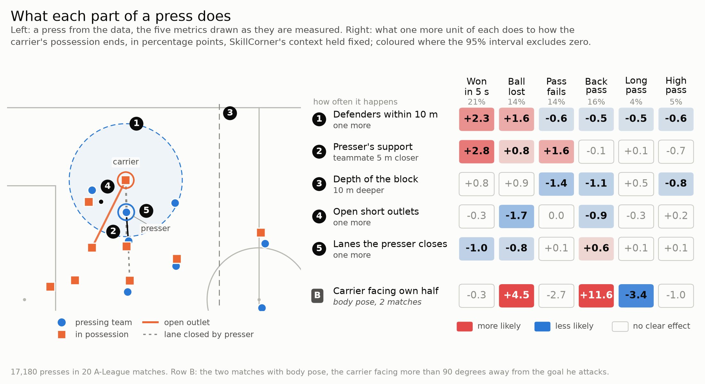
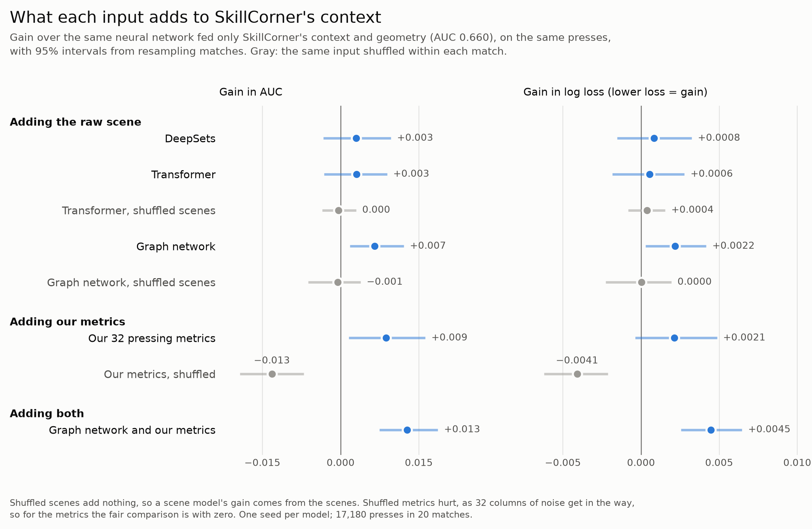

# Not how hard, but how: the shape of a collective press

SkillCorner x PySport Analytics Cup 2.0 · Alper Karayaz · [One minute video](VIDEO_URL)

Pressing is usually measured by how much a team presses (PPDA) or how hard (pressure, xloss). This project measures its shape from tracking: how many defenders converge, how close the support is, how compact the block is, which lanes are closed and how many outlets are left. With SkillCorner's context held fixed, it asks what each part does, and whether deep models on the raw scene find more.



**Figure 1.** One press with the five metrics drawn on it, and how each changes the outcome. [Animated version](ANIMATION_URL).

## Different parts of the press do different jobs

* **Numbers win the ball.** Each extra defender within 10 m of the carrier adds 2.3 points (95% CI 1.5 to 3.1) to the chance of a regain within 5 s, from a base rate of 21%. A teammate 5 m closer to the presser adds 2.8 (1.5 to 4.2). Both hold with 3 s and 8 s windows.
* **Closing lanes steers rather than wins.** Each lane in the presser's cover shadow lowers the regain chance by 1.0 point but forces more backward passes and fewer lost balls.
* **A compact block makes passes fail** (1.4 points more per 10 m shallower) without changing the regain rate.
* **Free outlets are the carrier's escape.** Each one lowers his chance of losing the ball by 1.7 points.

## Data and method

Twenty A-League 2024/25 matches from SkillCorner's open data: tracking at 10 fps and dynamic events. The unit is an on-ball engagement. The label is a regain within 5 s, rebuilt from the events and checked against SkillCorner's own `end_type`.

**Scene.** Each press is frozen on its first frame and rotated so the team in possession attacks to the right. Velocities are least squares slopes over the previous 0.5 s. Nothing after the start frame is read.

**Cleaning.** We measure the presser to carrier distance in each tracking frame and compare it with the event file's. The median gap is 5 mm and 96% agree within 0.5 m. Before dropping the 251 presses off by more than 2 m we looked for a cause: the tracks show no identity swaps, and scanning 5 s either side finds no common time offset, while agreeing presses match best on the start frame itself. The tail is scattered, not a shift affecting every scene. With 14 empty frames, 17,180 of 17,445 presses remain.

**Metrics.** Thirty two numbers: carrier position, presser approach, players within 5 and 10 m, open outlets by pass length, lanes closed, and the block's depth, width and line. Each is unit tested on hand built scenes.

**Validation.** Models are fitted leave one match out, intervals resample whole matches, and a placebo shuffles an input within each match to separate information from capacity. Effects come from a logistic regression with SkillCorner's context (xloss, pressure, distance, angle, zone, game state) as splines.

## Does the shape carry information?



**Figure 2.** Gains over a neural network fed only SkillCorner's context (AUC 0.660).

The headroom is small: SkillCorner's context does most of the work. Our metrics add 0.009 AUC (13 of 20 matches improve). DeepSets and a Transformer on the raw scene add nothing their shuffled versions do not. A graph network with distances on its edges adds 0.007, about as much as the metrics. Averaging the two gives 0.013 with 18 of 20 matches improving, so they capture partly different things. Gradient boosting agrees (0.017 AUC) but improves 13 of 20 matches, one short of our decision rule.

## Beyond the press itself

**Team profiles.** CC Mariners win 3.7 points fewer regains than expected (0.4 to 7.1). Across the 8 teams with three or more matches, teams that close more lanes beat expectation (Spearman r = 0.79) and teams that leave more outlets fall short (r = −0.81). With 8 teams this is exploratory.

**PPDA.** Rebuilt from the events, with engagements as defensive actions. Across 13 teams it tracks how often a team presses in the opponent's half (r = −0.79), but not the shape of its press (density r = −0.26, support r = −0.03) or its regains over expectation (r = −0.35). PPDA says how much a team presses, not how.

**Body pose pilot.** SkillCorner's 3D body pose (29 joints, 25 fps) for two matches, joined to tracking frame by frame after checking the alignment: 1,871 presses. Where the presser comes from makes no clear difference once we know which way the carrier faces. A carrier facing his own half plays backwards 11.6 points more often (7.4 to 16.3), loses the ball 4.5 points more (0.3 to 8.8) and plays long 3.4 points less. It does not yet improve prediction across matches.

## Limitations and next steps

Twenty matches, one season, one seed per neural model. The effects are associations: a team may commit more players when a press already looks winnable, and SkillCorner's context removes only part of that. With several outcomes per metric, the scripts report how many significant results chance would produce. Next: body pose for a full season, a leaner metric set (shuffled metrics show noise columns cost accuracy), and what the graph sees that the metrics miss.

## Use it

```bash
pip install -e .
```

```python
from pressing.api import press_metrics, HEADLINE

players = [
    {"id": 10, "x": 12.0, "y": -4.0, "side": "attacking"},
    {"id": 4, "x": 15.5, "y": -3.0, "side": "pressing", "vx": -3.0, "vy": 0.2},
    # ... everyone on the pitch
]
m = press_metrics(players, presser=4, carrier=10, ball=(12.3, -4.1))
m[HEADLINE["press density"]]  # defenders within 10 m of the carrier
```

Any tracking provider works: metres, origin at the centre spot, `attack="left"` if the team in possession attacks left.

**Reproduce.** Put the [SkillCorner open data](https://github.com/SkillCorner/opendata) in `data/` (paths in `pressing/config.py`) and run `bash scripts/reproduce.sh`.

## Licence

Code: MIT ([LICENSE.md](LICENSE.md)). Data: SkillCorner's, not included, used under their open data licence.
